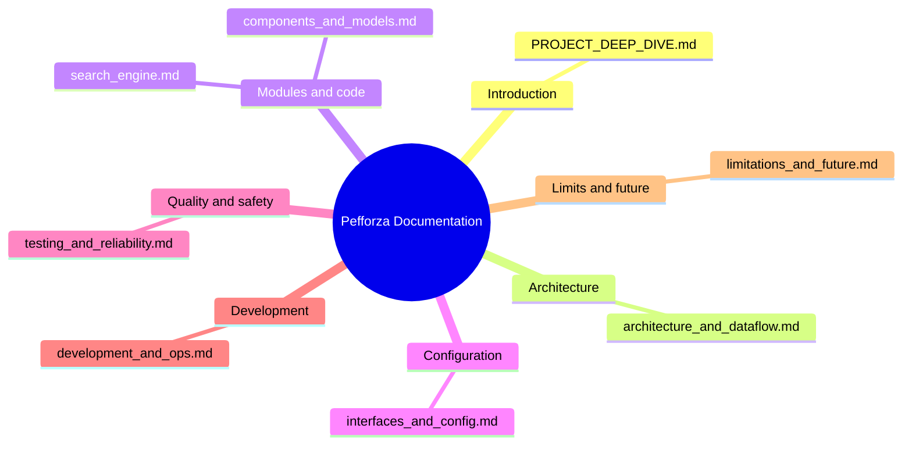

# Pefforza Technical Documentation: Overview

> 🇮🇹 [Versione italiana](it/PROJECT_DEEP_DIVE.md)

Welcome to the technical documentation of **Pefforza** (Connect Four AI with
computer vision, text-to-speech and perfect play). It is split into focused
modules for quick onboarding and in-depth understanding.

---

## Document map

1. **[PROJECT_DEEP_DIVE.md (this file)](PROJECT_DEEP_DIVE.md)**: executive
   summary, problem statement and documentation map.
2. **[Architecture and data flow](architecture_and_dataflow.md)**: component
   diagram, execution lifecycle of every entrypoint (CLI, GUI, AR) and the
   path of the data from a camera frame to the agent's move.
3. **[Components, files and domain model](components_and_models.md)**:
   repository map, class-by-class breakdown, in-memory data structures and a
   concept index.
4. **[Search engine](search_engine.md)**: the matrix baseline, the bitboard
   engines, the exact solver, the opening book and how perfect play is
   measured.
5. **[Interfaces, CLI and configuration](interfaces_and_config.md)**: every
   command, environment variables and the runtime/dev dependency map.
6. **[Testing and reliability](testing_and_reliability.md)**: the pytest
   suite, the exact oracle, error handling and reliability/safety criteria.
7. **[Development guide, examples and extensions](development_and_ops.md)**:
   setup, local commands, an end-to-end trace of a physical-board move, and
   how to extend the AI or the voice.
8. **[Limitations, future work and glossary](limitations_and_future.md)**:
   known limits, the prioritized roadmap and key terms.

Presentation material lives in [presentation_outline.md](presentation_outline.md)
and [gamma_prompt.md](gamma_prompt.md); the original technical improvement plan
(Italian) is [it/Pefforza_4_Piano_Miglioramenti_Tecnici.docx](it/Pefforza_4_Piano_Miglioramenti_Tecnici.docx).

---

## 1. Executive summary

**Pefforza** is an integrated system of artificial intelligence, computer
vision and voice interaction for playing Connect Four (Forza 4) both on
screen and on a real physical board. It combines an exact game solver,
classic heuristic search and a neural network trained from the solver's
labels into an interactive, challenging opponent.

### Main features

* **Computer vision**: a webcam finds the physical 6 x 7 board
  automatically (or from four clicked corners), rectifies its perspective and
  classifies every cell (empty, red, yellow) in HSV color space. The color
  thresholds re-fit themselves to the room's lighting from every validated
  reading, and a validator rejects physically impossible readings (a hand
  over the board, a token caught mid-drop) before they reach the AI.
* **Five difficulty levels**: random, a 1-ply heuristic, a bitboard
  alpha-beta search, the **perfect** `impossible` tier (exact opening book +
  exact solver, measured move by move against an independent oracle), and a
  neural network distilled from exact solver labels.
* **Voice interaction**: an asynchronous, fail-soft text-to-speech engine
  (`pyttsx3`) comments on the AI's moves in real time.
* **Three ways to play**:
  1. **Terminal (CLI)** for a quick text game.
  2. **Pygame GUI** with smooth falling-token animations and a *watchdog*
     that logs any obvious tactical mistake by the AI.
  3. **Augmented-reality assistant** for a physical board, on demand (SPACE)
     or continuously (`--watch`), drawing the recommended column on the live
     camera feed.

---

## 2. Problem statement

Connect Four is thoroughly studied: it is a solved game of perfect
information (the first player can always force a win by starting in the
center). Bringing that knowledge to a **real physical board** raises several
hard problems:

1. **Bridging analog and digital.** Reading the game through a camera must
   be robust to lighting changes, shadows, perspective distortion and visual
   noise. Fixed pixel coordinates break as soon as the camera or the board
   moves, and fixed color thresholds break when the room gets darker.
2. **Real time.** Decisions must arrive within a few seconds so the game
   stays fluid - yet a pure-Python search cannot prove the opening of
   Connect Four interactively.
3. **Trust.** A neural policy can have tactical blind spots, and a single
   misread frame can make any engine give confident nonsense. "Perfect" must
   be measured, not assumed.

Pefforza addresses them with:

* an OpenCV pipeline that locates the board from the lattice of its holes,
  warps it to a rectangle, classifies cells with adaptive HSV thresholds and
  validates every reading against gravity, turn order and the game history;
* an exact solver with an **opening book** generated offline by a native
  solver (533k positions up to ply 17) so the strongest tier plays perfectly
  from the first move, and anytime root proofs past the book;
* an **exact oracle** (positions with the solver score of every column) that
  grades every tier move by move;
* a deterministic 1-ply **tactical safety net** that wraps the search tiers;
* a queue-based worker thread that keeps text-to-speech from ever blocking
  the game.
