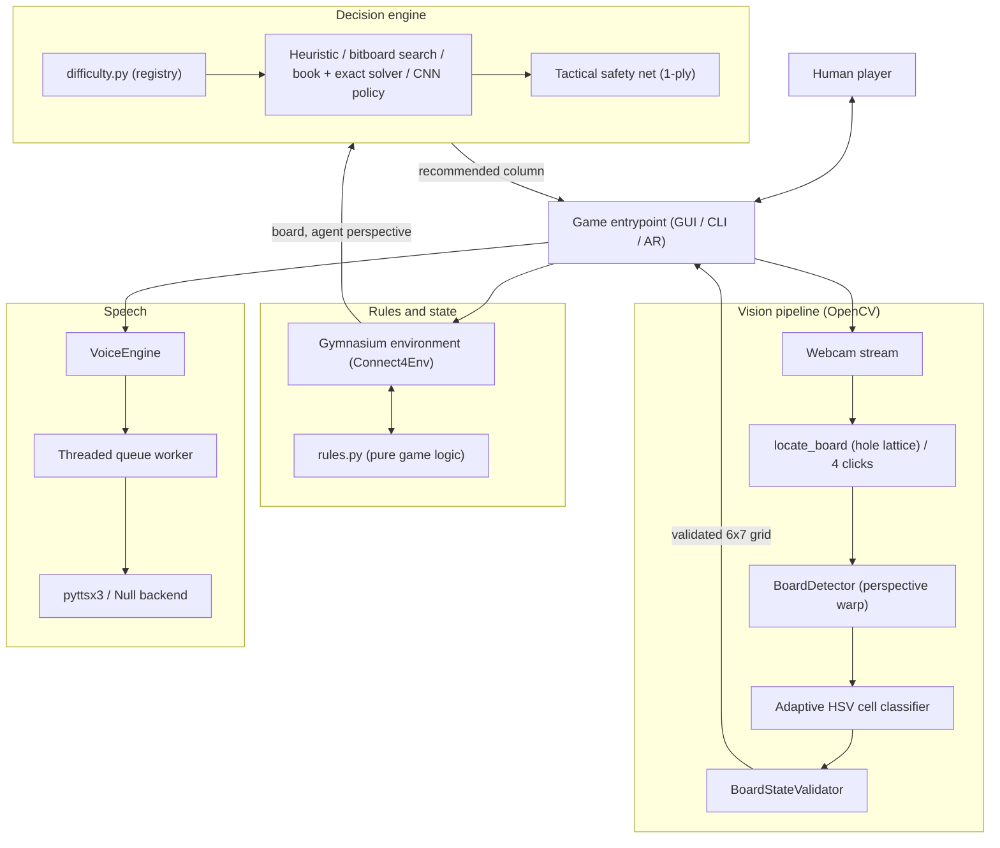
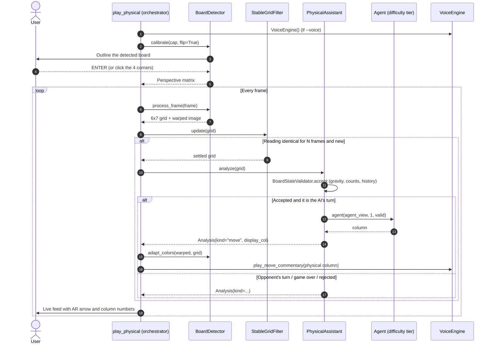

# System Architecture and Data Flow

> 🇮🇹 [Versione italiana](it/architecture_and_dataflow.md)

This document describes the overall architecture of **Pefforza**, the
execution lifecycle of each entrypoint, and the path data takes from hardware
input to user output.

---

## 1. High-level architecture

Pefforza follows a decoupled, modular design: the interaction and vision
modules talk to the game logic and the decision engine through standardized
data structures (mainly 2-D NumPy arrays).

### Building blocks

1. **Entrypoints (orchestration layer)** receive user input (mouse, keyboard,
   camera), coordinate the components, run the game loop and draw on screen
   (Pygame or OpenCV).
2. **Vision pipeline** locates the physical board - automatically from the
   6 x 7 lattice of holes in the blue frame, or from four clicked corners -
   applies a perspective transform to get a clean rectangular image and
   classifies it cell by cell. Every reading then passes the
   `BoardStateValidator`; accepted readings also re-fit the color thresholds
   to the current lighting.
3. **Core game logic** holds the formal game state (the 6 x 7 board),
   applies gravity and decides wins and draws. The Gymnasium environment
   wraps it for training.
4. **Decision engine** picks the column to play, using the agent of the
   chosen difficulty. The search tiers are wrapped by the
   `tactical_safety_net`, which always takes an immediate win and blocks an
   immediate threat.
5. **Interaction engine** is a producer-consumer design: the main thread
   queues phrases, a daemon worker speaks them, so synchronous `pyttsx3`
   calls never stall the frame rate.

---

## 2. Main execution flow

The flow depends on the entrypoint. In detail, the physical-board assistant
in watch mode (`pefforza-physical --watch`, also what the repo-root
[main.py](../main.py) runs):

### Entrypoint lifecycles

* **`pefforza-cli` / play_cli.py**: creates a `Connect4Env` and loops until
  the game ends. Human input is validated before it reaches the env
  (`get_human_action`); for the AI it measures thinking time, optionally
  speaks the move and calls `env.step()`.
* **`pefforza-gui` / play_gui.py**: starts Pygame; `MOUSEMOTION` moves the
  preview token, `MOUSEBUTTONDOWN` drops it with a quadratic ease-in
  animation. On the AI's turn it shows "AI thinking..." and runs the agent.
  The built-in *watchdog* (`watchdog_diagnostic`) writes to `watchdog.log`
  whenever the AI ignores a blockable threat.
* **`pefforza-physical` / play_physical.py**: AR assistant. By default it
  waits for SPACE, captures a frame, validates the reading and, on the AI's
  turn, draws a persistent arrow over the recommended column. With
  `--watch` it analyzes continuously, debounced by `StableGridFilter`, and
  announces each new recommendation once. `r` resets board tracking.

---

## 3. Data flow

Analog data (video) becomes discrete digital matrices, is validated and
transformed, and finally returns as visual or spoken output.

```mermaid
flowchart LR
    FrameIn["1. Camera frame (BGR)"] --> Warp["2. Perspective transform (3x3 matrix)"]
    Warp --> Crop["3. Warped image (700x600)"]
    Crop --> HSV["4. HSV masks (adaptive red/yellow bands)"]
    HSV --> Classify["5. Fill-ratio threshold"]
    Classify --> GridView["6. Vision grid (int8: red=1, yellow=2)"]
    GridView --> Validate["7. Validation (gravity, turn, history)"]
    Validate --> PerspSwap["8. Perspective swap (self=1, opponent=2)"]
    PerspSwap --> AgentLogic["9. Decision engine"]
    AgentLogic --> RecCol["10. Recommended column (0-6)"]
    RecCol --> OutputAR["11. AR arrow over the column"]
    RecCol --> OutputVoice["12. TTS announcement (physical column)"]
```

### Pipeline steps

1. **Video input**: raw OpenCV frame in BGR, mirrored for a natural view.
2. **Perspective homography**: the frame is warped so the board's playing
   area becomes a uniform 700 x 600 image.
3. **HSV filtering**: the rectified board is converted to HSV and masked for
   red (two hue ranges, because red wraps around the H axis) and yellow. The
   ranges come from the detector's `ColorProfile`, re-fitted to the lighting
   from validated readings.
4. **Confidence**: for each of the 42 cells (inset by 20% to ignore the
   plastic frame) the fraction of matching pixels is measured; above 30%
   the cell takes that color.
5. **Validation**: the grid must satisfy gravity, red-first token counts,
   a plausible outcome and a legal transition from the last accepted state;
   otherwise it is rejected and never reaches the AI.
6. **Agent normalization**: vision uses red = `1`, yellow = `2`; agents
   always see themselves as `1`, so the grid goes through
   `rules.swap_perspective` when the AI plays yellow.
7. **Decision and output**: the returned column lives in display space (the
   mirrored frame); the arrow is drawn there, while the printed and spoken
   recommendation is translated with `BoardDetector.physical_col` to the
   column a human counts on the real board.
