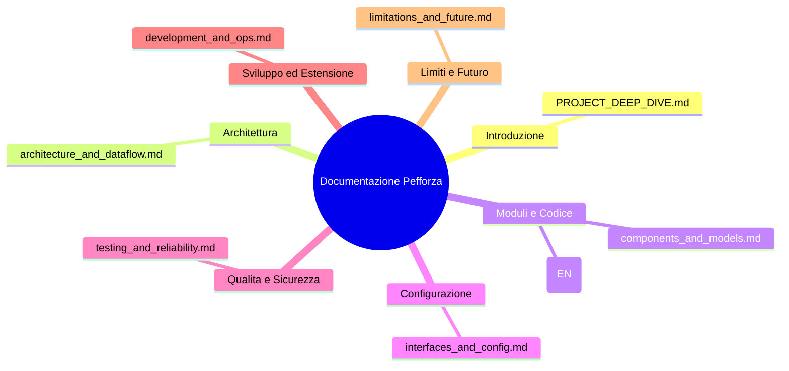

# Documentazione Tecnica Pefforza: Indice Generale

> 🇬🇧 [English version](../PROJECT_DEEP_DIVE.md)

Benvenuto nella documentazione tecnica del progetto **Pefforza** (Forza 4 con
computer vision, sintesi vocale e gioco perfetto). La documentazione è divisa
in moduli per consentire un onboarding rapido e una comprensione approfondita.

---

## Mappa dei Documenti

1. **[PROJECT_DEEP_DIVE.md (questo file)](PROJECT_DEEP_DIVE.md)**: executive
   summary, problem statement e mappa della documentazione.
2. **[Architettura e flussi di dati](architecture_and_dataflow.md)**:
   diagramma dei componenti, ciclo di vita di ogni entrypoint (CLI, GUI e AR)
   e percorso dei dati dal frame della camera fino alla mossa dell'agente.
3. **[Componenti, file e modelli di dominio](components_and_models.md)**:
   mappa del repository, scomposizione classe per classe, strutture dati in
   memoria e indice dei concetti.
4. **[Motore di ricerca](../search_engine.md)** (in inglese): baseline a
   matrice, motori bitboard, solver esatto, opening book e misura del gioco
   perfetto.
5. **[Interfacce, CLI e configurazione](interfaces_and_config.md)**: tutti i
   comandi, le variabili d'ambiente e la mappa delle dipendenze.
6. **[Test e affidabilità](testing_and_reliability.md)**: suite pytest,
   oracolo esatto, gestione degli errori e criteri di affidabilità/sicurezza.
7. **[Guida allo sviluppo, esempi ed estensioni](development_and_ops.md)**:
   installazione, comandi locali, tracciamento end-to-end di una mossa sulla
   scacchiera fisica, come estendere l'IA o la voce.
8. **[Limiti, sviluppi futuri e glossario](limitations_and_future.md)**:
   limiti noti, roadmap prioritaria e termini chiave.

Il materiale per la presentazione si trova in
[presentation_outline.md](presentation_outline.md) e
[gamma_prompt.md](gamma_prompt.md); il piano originale di miglioramenti tecnici è
[Pefforza_4_Piano_Miglioramenti_Tecnici.docx](Pefforza_4_Piano_Miglioramenti_Tecnici.docx).

---

## 1. Executive Summary

**Pefforza** è un sistema integrato di intelligenza artificiale, computer
vision e interazione vocale per giocare a Forza 4 (Connect 4) sia a schermo
sia su una scacchiera fisica reale. Combina un solver esatto del gioco, la
ricerca euristica classica e una rete neurale addestrata sulle etichette del
solver per creare un avversario interattivo e stimolante.

### Funzionalità principali

* **Visione artificiale**: la webcam trova automaticamente la scacchiera
  6 x 7 (oppure si cliccano i quattro angoli), ne raddrizza la prospettiva e
  classifica ogni cella (vuota, rossa, gialla) nello spazio colore HSV. Le
  soglie di colore si adattano da sole all'illuminazione della stanza a ogni
  lettura validata, e un validatore scarta le letture fisicamente impossibili
  (una mano sulla scacchiera, una pedina a metà caduta) prima che arrivino
  all'IA.
* **Cinque livelli di difficoltà**: casuale, euristica a 1 ply, ricerca
  alpha-beta su bitboard, il livello `impossible` **perfetto** (opening book
  esatto + solver esatto, verificato mossa per mossa contro un oracolo
  indipendente) e una rete neurale distillata dalle etichette esatte del
  solver.
* **Interazione vocale**: un motore text-to-speech asincrono e "fail-soft"
  (`pyttsx3`) commenta in tempo reale le mosse dell'IA.
* **Tre modalità di gioco**:
  1. **Terminale (CLI)** per una partita veloce testuale.
  2. **GUI Pygame** con animazioni fluide di caduta e un *watchdog* che
     registra ogni errore tattico evidente dell'IA.
  3. **Assistente in realtà aumentata** per la scacchiera fisica, su
     richiesta (SPAZIO) o continuo (`--watch`), che disegna la colonna
     consigliata sul feed live della camera.

---

## 2. Problem Statement

Il Forza 4 è un gioco a informazione perfetta risolto matematicamente: il
primo giocatore può sempre forzare la vittoria iniziando al centro. Portare
questa conoscenza su una **scacchiera fisica reale** introduce problemi
complessi:

1. **Ponte tra analogico e digitale.** Leggere la partita con una camera
   richiede robustezza a variazioni di luce, ombre, distorsione prospettica
   e rumore. Coordinate fisse in pixel falliscono appena la camera o la
   scacchiera si spostano, e soglie di colore fisse falliscono quando la
   stanza diventa più buia.
2. **Tempo reale.** Le decisioni devono arrivare in pochi secondi, ma una
   ricerca in Python puro non riesce a dimostrare l'apertura del Forza 4 in
   modo interattivo.
3. **Fiducia.** Una policy neurale può avere punti ciechi tattici e un
   singolo frame letto male può far dare a qualsiasi motore una risposta
   sicura ma sbagliata. "Perfetto" va misurato, non presunto.

Pefforza risponde con:

* una pipeline OpenCV che localizza la scacchiera dal reticolo dei suoi
  fori, la raddrizza, classifica le celle con soglie HSV adattive e valida
  ogni lettura rispetto a gravità, ordine dei turni e storia della partita;
* un solver esatto con un **opening book** generato offline da un solver
  nativo (533k posizioni fino al ply 17), così il livello più forte gioca in
  modo perfetto dalla prima mossa, e dimostrazioni "anytime" oltre il book;
* un **oracolo esatto** (posizioni con il punteggio del solver per ogni
  colonna) che valuta ogni livello mossa per mossa;
* una **tactical safety net** deterministica a 1 ply attorno ai livelli di
  ricerca;
* un thread di lavoro basato su coda che impedisce alla sintesi vocale di
  bloccare il gioco.
