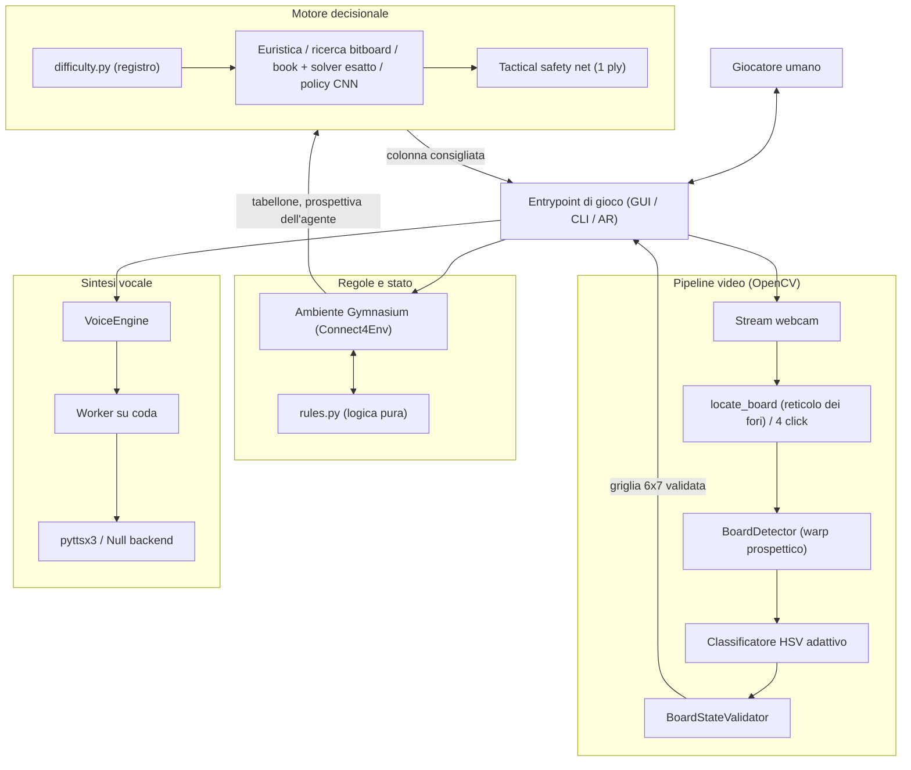
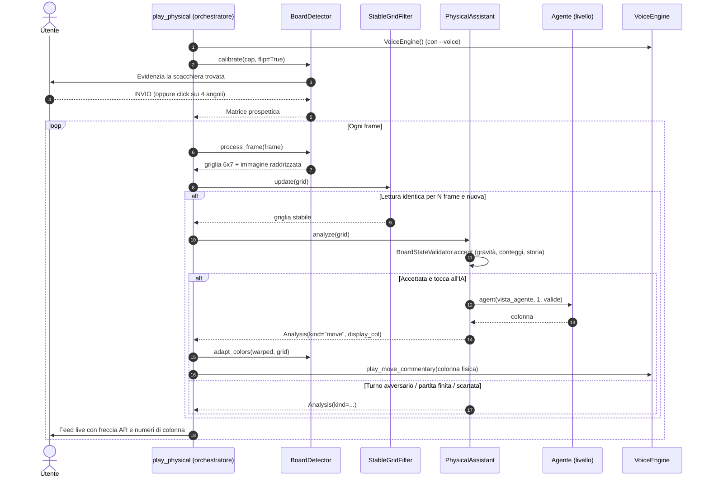

# Architettura di Sistema e Flusso dei Dati

> 🇬🇧 [English version](../architecture_and_dataflow.md)

Questo documento analizza l'architettura generale di **Pefforza**, il ciclo di
vita di ciascun entrypoint e il percorso dei dati dall'input hardware
all'output per l'utente.

---

## 1. Architettura di alto livello

Pefforza segue un modello modulare e disaccoppiato: i moduli di interazione e
visione comunicano con la logica di gioco e il motore decisionale tramite
strutture dati standard (principalmente array NumPy 2D).

### Blocchi architetturali

1. **Entrypoint (orchestrazione)**: riceve gli input (mouse, tastiera,
   camera), coordina i componenti, esegue il ciclo di gioco e disegna a
   schermo (Pygame o OpenCV).
2. **Pipeline di visione**: localizza la scacchiera fisica -
   automaticamente dal reticolo 6 x 7 dei fori nella cornice blu, oppure dai
   quattro angoli cliccati - applica la trasformazione prospettica e
   classifica l'immagine cella per cella. Ogni lettura passa poi dal
   `BoardStateValidator`; le letture accettate riadattano anche le soglie di
   colore all'illuminazione corrente.
3. **Logica di gioco**: mantiene lo stato formale (tabellone 6 x 7), applica
   la gravità e decide vittorie e pareggi. L'ambiente Gymnasium la avvolge
   per l'addestramento.
4. **Motore decisionale**: sceglie la colonna con l'agente della difficoltà
   selezionata. I livelli di ricerca sono avvolti dalla
   `tactical_safety_net`, che prende sempre una vittoria immediata e blocca
   una minaccia immediata.
5. **Interazione vocale**: produttore-consumatore; il thread principale
   accoda le frasi e un worker daemon le pronuncia, così le chiamate
   sincrone di `pyttsx3` non rallentano mai il frame rate.

---

## 2. Flusso di esecuzione principale

Il flusso dipende dall'entrypoint. In dettaglio, l'assistente per la
scacchiera fisica in modalità continua (`pefforza-physical --watch`, ciò che
esegue anche [main.py](../../main.py)):

### Ciclo di vita degli entrypoint

* **`pefforza-cli` / play_cli.py**: crea un `Connect4Env` e cicla fino alla
  fine della partita. L'input umano viene validato prima di arrivare
  all'ambiente (`get_human_action`); per l'IA misura il tempo di pensiero,
  pronuncia la mossa (opzionale) e chiama `env.step()`.
* **`pefforza-gui` / play_gui.py**: avvia Pygame; `MOUSEMOTION` sposta la
  pedina di anteprima, `MOUSEBUTTONDOWN` la lascia cadere con
  un'animazione quadratica. Nel turno dell'IA mostra "AI thinking..." ed
  esegue l'agente. Il *watchdog* (`watchdog_diagnostic`) scrive in
  `watchdog.log` ogni volta che l'IA ignora una minaccia bloccabile.
* **`pefforza-physical` / play_physical.py**: assistente AR. Di default
  aspetta SPAZIO, cattura un frame, valida la lettura e, nel turno
  dell'IA, disegna una freccia persistente sulla colonna consigliata. Con
  `--watch` analizza di continuo, con il filtro di stabilità
  `StableGridFilter`, e annuncia una sola volta ogni nuova raccomandazione.
  `r` azzera il tracciamento.

---

## 3. Flusso dei dati

I dati analogici (video) diventano matrici digitali discrete, vengono
validati e trasformati, e tornano come output visivo o vocale.

```mermaid
flowchart LR
    FrameIn["1. Frame camera (BGR)"] --> Warp["2. Trasformazione prospettica (matrice 3x3)"]
    Warp --> Crop["3. Immagine raddrizzata (700x600)"]
    Crop --> HSV["4. Maschere HSV (bande rosso/giallo adattive)"]
    HSV --> Classify["5. Soglia di riempimento"]
    Classify --> GridView["6. Griglia visiva (int8: rosso=1, giallo=2)"]
    GridView --> Validate["7. Validazione (gravità, turno, storia)"]
    Validate --> PerspSwap["8. Cambio prospettiva (self=1, avversario=2)"]
    PerspSwap --> AgentLogic["9. Motore decisionale"]
    AgentLogic --> RecCol["10. Colonna consigliata (0-6)"]
    RecCol --> OutputAR["11. Freccia AR sulla colonna"]
    RecCol --> OutputVoice["12. Annuncio vocale (colonna fisica)"]
```

### Passaggi della pipeline

1. **Input video**: frame OpenCV grezzo in BGR, specchiato per una visione
   naturale.
2. **Omografia prospettica**: il frame viene proiettato in modo che l'area
   di gioco diventi un'immagine uniforme di 700 x 600 pixel.
3. **Filtraggio HSV**: la scacchiera raddrizzata viene convertita in HSV e
   mascherata per il rosso (due intervalli di hue, perché il rosso "gira"
   attorno all'asse H) e il giallo. Gli intervalli vengono dal `ColorProfile`
   del detector, riadattato alla luce dalle letture validate.
4. **Confidenza**: per ognuna delle 42 celle (ridotte del 20% per ignorare la
   plastica della griglia) si misura la frazione di pixel compatibili; sopra
   il 30% la cella prende quel colore.
5. **Validazione**: la griglia deve rispettare gravità, conteggi con il
   rosso che inizia, un esito coerente e una transizione legale dall'ultimo
   stato accettato; altrimenti viene scartata e non arriva mai all'IA.
6. **Normalizzazione per l'agente**: la visione usa rosso = `1`, giallo = `2`;
   gli agenti si vedono sempre come `1`, quindi la griglia passa da
   `rules.swap_perspective` quando l'IA gioca il giallo.
7. **Decisione e output**: la colonna restituita è nello spazio dello
   schermo (il frame specchiato); la freccia viene disegnata lì, mentre la
   raccomandazione stampata e pronunciata viene tradotta con
   `BoardDetector.physical_col` nella colonna che un umano conta sulla
   scacchiera reale.
